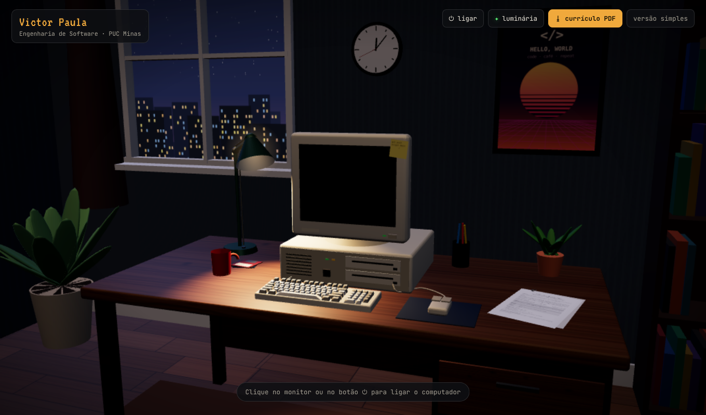

# 🧑‍💻 Portfólio — Victor Reis Silva de Paula

> Site de portfólio profissional, simples e responsivo, bilíngue (PT/EN), com seções **Sobre mim**, **Projetos** (linha do tempo), **Experiências** e **Contato** (formulário com envio por e-mail).

[](https://react.dev)
[](https://vite.dev)
[](https://vercel.com)

---

## 📚 Índice
- [Links Úteis](#-links-úteis)
- [Sobre o Projeto](#-sobre-o-projeto)
- [Funcionalidades Principais](#-funcionalidades-principais)
- [Tecnologias Utilizadas](#-tecnologias-utilizadas)
- [Arquitetura](#-arquitetura)
- [Instalação e Execução](#-instalação-e-execução)
- [Deploy](#-deploy)
- [Estrutura de Pastas](#-estrutura-de-pastas)
- [Personalizando o conteúdo](#-personalizando-o-conteúdo)
- [Demonstração](#-demonstração)
- [Autor](#-autor)

---

## 🔗 Links Úteis
* 🌐 **Site publicado:** _adicione aqui o link da Vercel após o deploy_ (ex.: `https://portfolio-3d.vercel.app`)
* 💻 **Repositório:** https://github.com/VCTRPL/Portfolio-3D
* 🕹️ **Versão 3D (extra):** acrescente `?3d` à URL do site

---

## 📝 Sobre o Projeto
Portfólio criado para apresentar minha trajetória, habilidades, projetos e formas de contato de maneira moderna e acessível. Sou estudante de Engenharia de Software na PUC Minas e busco minha primeira oportunidade na área. O site foi feito como trabalho acadêmico de Desenvolvimento e Integração de Aplicações Web, com tema escuro, tipografia Inter e gradiente índigo → turquesa como identidade visual.

## ✨ Funcionalidades Principais
- 🧭 **Menu de navegação** fixo, com destaque da seção atual e menu "hambúrguer" no celular.
- 🌎 **Português / English:** botão de idioma no topo e na seção "Sobre mim"; a escolha é lembrada.
- 👤 **Sobre mim:** apresentação bilíngue, formação, competências, idiomas e objetivo.
- 🗓️ **Projetos:** linha do tempo do mais antigo ao mais recente, com descrição, tecnologias, link do GitHub e imagem. Os repositórios públicos de `github.com/VCTRPL` entram automaticamente (API do GitHub).
- 💼 **Experiências:** formação, projetos e vivências (empresa/instituição, atividade, período e descrição).
- ✉️ **Contato:** ícones clicáveis (e-mail, WhatsApp, LinkedIn, GitHub) e formulário (nome, e-mail, mensagem) validado com React Hook Form e enviado por EmailJS.
- ♿ Acessível: navegação por teclado, `aria-*`, "pular para o conteúdo" e respeito a `prefers-reduced-motion`.
- 📱 Responsivo (testado de 360 px a desktop).

---

## 🛠 Tecnologias Utilizadas
### 💻 Front-end
* **Biblioteca:** React 19.2 (JavaScript ES6+)
* **Build tool:** Vite 7
* **Estilização:** CSS puro com variáveis (`src/site/site.css`)
* **Formulário:** React Hook Form
* **E-mail:** EmailJS (`@emailjs/browser`), direto do front-end
* **Extra (versão 3D):** Three.js, React Three Fiber, drei, Zustand, maath

### ⚙️ Infraestrutura
* **Hospedagem:** Vercel (gratuita)
* **Versionamento:** Git + GitHub

### 📦 Dependências (`package.json`)
| Pacote | Uso |
| --- | --- |
| `react`, `react-dom` | Interface |
| `react-hook-form` | Validação do formulário |
| `@emailjs/browser` | Envio de e-mail |
| `three`, `@react-three/fiber`, `@react-three/drei`, `maath`, `zustand` | Versão 3D (`?3d`, carregada sob demanda) |
| `vite`, `@vitejs/plugin-react` | Build e servidor de desenvolvimento (dev) |

---

## 🏗 Arquitetura
Aplicação **single-page estática** (sem back-end próprio): os dados ficam em `src/site/data`, o idioma é controlado por um Context (`i18n.jsx`) e cada seção é um componente. Projetos = lista curada + repositórios do GitHub buscados no navegador (com cache de sessão e mensagem de erro caso o limite da API seja atingido). O e-mail é enviado pelo EmailJS sem servidor; sem configuração, o formulário cai para `mailto:`. A cena 3D é um chunk separado (`import()` dinâmico), então não pesa no site principal.

---

## 🔧 Instalação e Execução
### Pré-requisitos
* Node.js 18+ e npm

### Variáveis de ambiente (envio de e-mail)
1. Crie uma conta em [emailjs.com](https://www.emailjs.com), um *Email Service* e um *Template* que use `{{from_name}}`, `{{from_email}}`, `{{reply_to}}` e `{{message}}`.
2. Copie `.env.example` para `.env` e preencha:
```bash
VITE_EMAILJS_SERVICE_ID=service_xxxxxxx
VITE_EMAILJS_TEMPLATE_ID=template_xxxxxxx
VITE_EMAILJS_PUBLIC_KEY=xxxxxxxxxxxxxxxx
```
> A chave pública do EmailJS é feita para ficar no front-end. Ative restrição de domínio no painel deles.

### Rodando
```bash
git clone https://github.com/VCTRPL/Portfolio-3D.git
cd Portfolio-3D
npm install
npm run dev        # http://localhost:5173
npm run build      # gera dist/
npm run preview    # serve o build local
```

---

## 🚀 Deploy
1. Em [vercel.com](https://vercel.com), **Add New → Project** e importe `VCTRPL/Portfolio-3D`.
2. Framework: Vite (já definido em `vercel.json`). Em **Settings → Environment Variables** adicione as três variáveis `VITE_EMAILJS_*`.
3. Deploy. Cada `git push` na `main` publica de novo automaticamente.
4. Cole o link final na seção [Links Úteis](#-links-úteis).

---

## 📂 Estrutura de Pastas
```
Portfolio-3D/
├── public/
│   ├── Curriculo_Victor_Reis_Silva_de_Paula.pdf
│   ├── favicon.svg
│   ├── projects/            # imagens/GIFs dos projetos
│   ├── cursors/ textures/   # usados pela versão 3D
├── src/
│   ├── main.jsx             # entrada: site (padrão) ou 3D (?3d)
│   ├── site/                # ⭐ site do portfólio
│   │   ├── SiteApp.jsx
│   │   ├── i18n.jsx         # idioma PT/EN + textos da interface
│   │   ├── useGithubProjects.js
│   │   ├── site.css
│   │   ├── data/            # profile, projects, experiences, contacts
│   │   └── components/      # Header, About, Projects, Experience, Contact, Footer…
│   ├── App3D.jsx            # versão 3D (escritório retrô)
│   ├── scene/ screen/       # cena 3D e site dentro do monitor
│   └── content.js store.js sound.js webgl.js
├── .env.example
├── index.html
├── vercel.json
└── vite.config.js
```

---

## 🎨 Personalizando o conteúdo
* **Textos / competências / idiomas:** `src/site/data/profile.js`
* **Experiências:** `src/site/data/experiences.js`
* **Projetos:** `src/site/data/projects.js` — coloque a imagem ou GIF em `public/projects/` e acrescente o objeto com nome, descrição, tecnologias, link do GitHub e `image`. Repositórios com o mesmo nome substituem a versão automática.
* **Contatos:** `src/site/data/contacts.js`

## 🎥 Demonstração


## 👤 Autor
**Victor Reis Silva de Paula** — [GitHub](https://github.com/VCTRPL) · [LinkedIn](https://www.linkedin.com/in/victor-paula-3b6a603b3/) · victorrsdp@gmail.com
